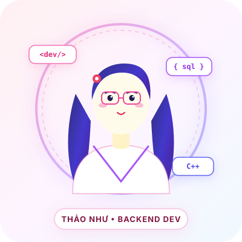

# Profile & Developer Portfolio - Nguyễn Thị Thảo Như

Website Portfolio cá nhân hiện đại, chuyên nghiệp dành cho sinh viên Công nghệ Thông tin định hướng phát triển **Backend Developer**.

---

## 📁 1. Cấu Trúc Thư Mục Dự Án

```
profile me/
│
├── index.html                  # File HTML chính chứa cấu trúc semantic toàn bộ trang web
├── style.css                   # File CSS định dạng Dark Mode, hiệu ứng và responsive
├── script.js                   # Logic JavaScript (Typing effect, Modal, Menu, Form Validation)
│
├── images/                     # Thư mục lưu trữ hình ảnh
│   ├── avatar-placeholder.svg  # Ảnh đại diện mẫu phong cách Developer
│   ├── project-portfolio.svg   # Ảnh minh họa Dự án 1 (Personal Portfolio)
│   ├── project-route.svg       # Ảnh minh họa Dự án 2 (HCM City Route Optimizer)
│   └── project-love.svg        # Ảnh minh họa Dự án 3 (Interactive Love Website)
│
└── README.md                   # Hướng dẫn chi tiết sử dụng, chỉnh sửa và deploy
```

---

## 🚀 2. Hướng Dẫn Mở & Chạy Website

Vì website được xây dựng hoàn toàn bằng **HTML5, CSS3 và JavaScript thuần**, bạn có thể chạy website theo các cách rất đơn giản sau:

### Cách 1: Chạy trực tiếp (Nhanh nhất)
1. Mở thư mục `profile me` trên máy tính của bạn (`C:\Users\nhu\OneDrive\Máy tính\profile me`).
2. Nhấp đúp chuột trực tiếp vào file **`index.html`**.
3. Trình duyệt mặc định (Chrome, Edge, Firefox, Cốc Cốc,...) sẽ tự động mở website.

### Cách 2: Sử dụng Live Server trên Visual Studio Code (Khuyên dùng khi lập trình)
1. Mở phần mềm **Visual Studio Code**.
2. Chọn **File** ➔ **Open Folder...** ➔ Chọn thư mục `profile me`.
3. Cài đặt tiện ích mở rộng (Extension) **Live Server** (tác giả Ritwick Dey).
4. Nhấp chuột phải vào file `index.html` ➔ Chọn **Open with Live Server** (hoặc bấm `Alt + L, Alt + O`).
5. Trang web sẽ mở tại địa chỉ `http://127.0.0.1:5500` và tự động cập nhật mỗi khi bạn lưu thay đổi code.

### Cách 3: Chạy bằng Python (Local Server)
Nếu máy bạn có cài đặt Python, mở Terminal/PowerShell tại thư mục `profile me` và gõ:
```bash
python -m http.server 8000
```
Sau đó mở trình duyệt và truy cập `http://localhost:8000`.

---

## 🖼️ 3. Hướng Dẫn Thay Ảnh Đại Diện (Avatar)

Hiện tại website đang sử dụng ảnh placeholder vector hiện đại `images/avatar-placeholder.svg`. Khi bạn muốn thay bằng ảnh chân dung thật:

1. Chuẩn bị 1 bức ảnh chân dung rõ nét của bạn (định dạng `.jpg`, `.png`, hoặc `.webp`).
2. Copy ảnh đó vào thư mục `images/` (ví dụ đặt tên là `avatar.jpg`).
3. Mở file `index.html`:
   - Tìm đến dòng Hero section (khoảng dòng 114):
     ```html
     <!-- SỬA DÒNG NÀY: -->
     
     ```
     Đổi thành:
     ```html
     
     ```
   - Tìm tiếp ở section **About Me** (khoảng dòng 147):
     ```html
     <div class="info-avatar-mini">
       
     </div>
     ```
4. Lưu file `index.html` và tải lại trang để thấy ảnh mới.

---

## ➕ 4. Hướng Dẫn Thêm Dự Án Mới

Website đã được thiết kế sẵn cấu trúc để bạn mở rộng thêm nhiều dự án Backend trong tương lai:

### Bước 1: Thêm thẻ hiển thị dự án trong `index.html`
Tại phần `<div class="projects-grid">` trong `index.html`, bạn copy khối dự án mẫu và dán vào phía trước thẻ placeholder:

```html
<!-- DỰ ÁN MỚI -->
<div class="project-card reveal" data-project-id="p4">
  <div class="project-image-box">
    
    <div class="project-overlay">
      <button class="btn btn-sm btn-primary open-modal-btn" data-project="p4">
        <i class="fa-solid fa-circle-info"></i> View Details
      </button>
    </div>
  </div>
  <div class="project-content">
    <div class="project-type-tag">Backend &amp; API</div>
    <h3 class="project-name">Tên Dự Án Của Bạn</h3>
    <p class="project-desc">
      Mô tả ngắn gọn về bài toán và tính năng chính của hệ thống.
    </p>
    <div class="project-tech-stack">
      <span>Python</span>
      <span>SQL</span>
      <span>Docker</span>
    </div>
    <div class="project-card-footer">
      <button class="btn btn-outline btn-xs open-modal-btn" data-project="p4">
        <i class="fa-solid fa-circle-info"></i> Details
      </button>
      <div class="project-links">
        <a href="https://github.com/username/ten-repo" target="_blank" rel="noopener noreferrer" class="icon-link" title="Source Code">
          <i class="fa-brands fa-github"></i>
        </a>
        <a href="#" class="icon-link" title="Live Preview">
          <i class="fa-solid fa-arrow-up-right-from-square"></i>
        </a>
      </div>
    </div>
  </div>
</div>
```

### Bước 2: Cập nhật thông tin chi tiết vào `script.js`
Mở file `script.js`, tìm đến biến `projectsData` và thêm key `p4`:

```javascript
p4: {
  name: "Tên Dự Án Của Bạn",
  category: "Backend & API Service",
  overview: "Tổng quan mô tả mục tiêu và kiến trúc của dự án.",
  problem: "Vấn đề thực tế mà dự án giải quyết.",
  solution: "Giải pháp kiến trúc, công nghệ và cơ sở dữ liệu đã lựa chọn.",
  technologies: ["Python", "SQL", "Docker", "Git"],
  algorithms: ["Hashing", "Caching Strategy", "Data Normalization"],
  features: [
    "Xây dựng RESTful API xử lý nghiệp vụ",
    "Tối ưu truy vấn cơ sở dữ liệu SQL",
    "Kiểm thử và đóng gói với Docker"
  ],
  challenges: "Khó khăn đã gặp phải trong quá trình thiết kế hệ thống.",
  learned: "Những kiến thức và kinh nghiệm đúc kết được sau dự án.",
  github: "https://github.com/username/ten-repo",
  demo: "https://demo-link-neu-co.com"
}
```

---

## 🔗 5. Hướng Dẫn Thay Link GitHub & LinkedIn

Hiện tại website đang đặt placeholder liên kết `https://github.com` và `https://linkedin.com`. Để cập nhật trang cá nhân của bạn:

1. Mở file `index.html`.
2. Dùng chức năng tìm kiếm (`Ctrl + F`) tìm từ khóa `https://github.com` và `https://linkedin.com`.
3. Thay thế bằng URL tài khoản cá nhân thực tế của bạn:
   - Thay `https://github.com` ➔ `https://github.com/tai-khoan-cua-ban`
   - Thay `https://linkedin.com` ➔ `https://linkedin.com/in/tai-khoan-cua-ban`
4. Lưu file lại là xong!

---

## 🌐 6. Hướng Dẫn Đưa Website Lên Mạng (Deploy)

Bạn có thể đưa trang web lên mạng hoàn toàn **miễn phí 100%** bằng GitHub Pages hoặc Vercel:

### Lựa Chọn 1: Deploy lên GitHub Pages (Rất khuyên dùng cho Developer)
1. Đăng nhập vào [GitHub](https://github.com).
2. Tạo một Repository mới, đặt tên dạng: `username.github.io` (hoặc `portfolio-profile`).
3. Đẩy toàn bộ mã nguồn trong thư mục `profile me` lên Repository này:
   ```bash
   git init
   git add .
   git commit -m "Initial portfolio commit"
   git branch -M main
   git remote add origin https://github.com/username/ten-repo.git
   git push -u origin main
   ```
4. Trên GitHub, vào mục **Settings** ➔ chọn tab **Pages** (ở cột bên trái).
5. Tại mục **Build and deployment**:
   - Source: Chọn `Deploy from a branch`.
   - Branch: Chọn `main` và thư mục `/ (root)`.
   - Bấm **Save**.
6. Chờ khoảng 1-2 phút, GitHub Pages sẽ cấp cho bạn một đường link công khai: `https://username.github.io/ten-repo`. Bạn có thể gắn link này vào CV xin thực tập!

### Lựa Chọn 2: Deploy lên Vercel (Cực nhanh và có SSL tự động)
1. Truy cập [vercel.com](https://vercel.com) và đăng nhập bằng tài khoản GitHub.
2. Bấm **Add New...** ➔ Chọn **Project**.
3. Chọn Repository chứa mã nguồn Portfolio của bạn.
4. Giữ nguyên các thiết lập mặc định (Framework Preset: *Other*) và bấm **Deploy**.
5. Trong vòng chưa đầy 30 giây, website của bạn sẽ online với tên miền dạng `https://ten-du-an.vercel.app`.

---

## ✨ Điểm Nổi Bật Của Website
- **Phong cách chuẩn Developer**: Dark Mode nền sâu kết hợp dải màu Neon Cyan & Indigo hiện đại.
- **Tối ưu tốc độ & SEO**: Không phụ thuộc framework cồng kềnh, tải trang tức thì, chuẩn thẻ Open Graph và Semantic HTML.
- **Tính năng tương tác đầy đủ**: Hiệu ứng gõ chữ, cuộn mượt, modal chi tiết dự án, timeline học vấn, form liên hệ có kiểm tra tính hợp lệ dữ liệu.
- **Responsive 100%**: Trải nghiệm mượt mà trên Desktop, Laptop, iPad và Smartphone.

